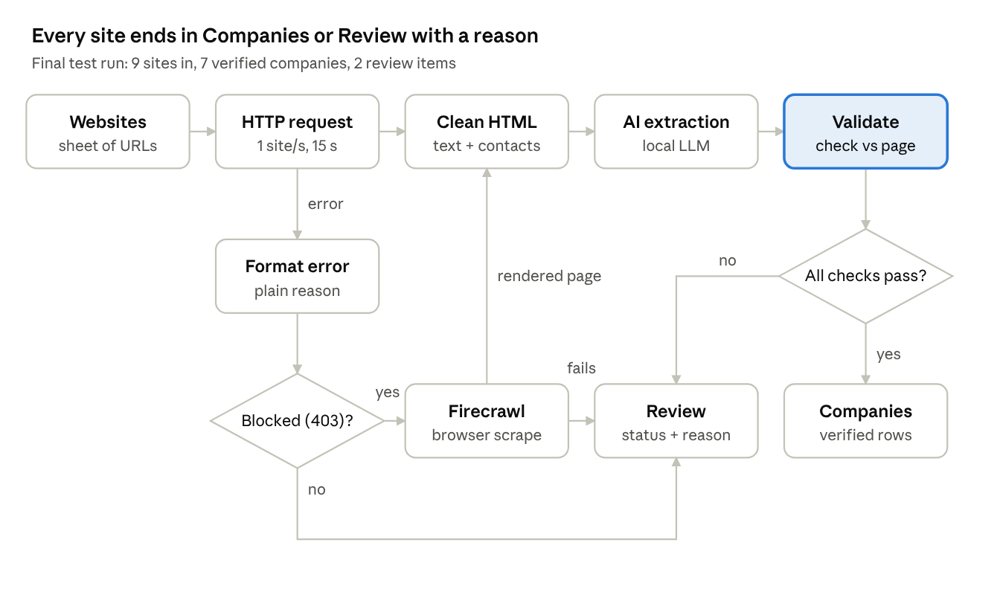
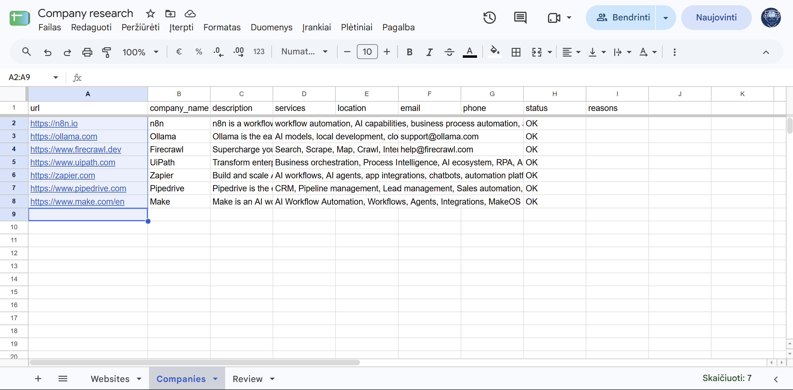
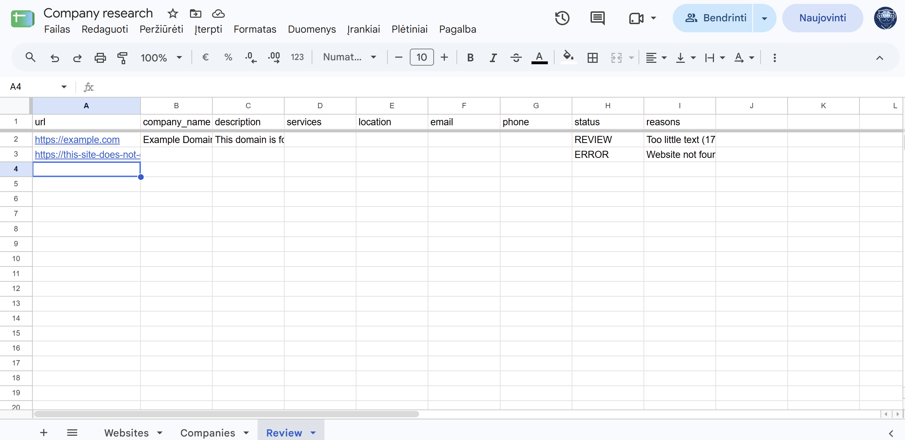
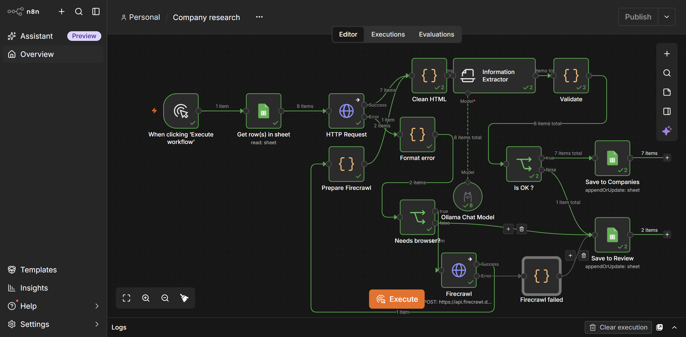

# Company research with AI extraction and validation

Turns a list of website URLs into a verified company table: name, description, services, location and public contacts. Every uncertain or failed site ends up in a **Review** tab with its reason.

## What it does

- Reads URLs from a Google Sheet and visits each site at a polite rate.
- Extracts readable text with code; finds public emails and phone numbers from links, format-checked.
- A local LLM structures the description, services and location. Fields may be empty; nothing is guessed.
- **Validation:** the company name must appear on the page or in the domain, a location must appear word for word, and pages with too little text are flagged.
- **Sites that block bots (HTTP 403)** get one browser-based attempt through Firecrawl, then go through the same checks.
- **Dead domains and timeouts** become Review rows with a plain-language reason.
- Re-running updates rows instead of duplicating them.

| Companies (verified) | Review (with reasons) |
| --- | --- |
|  |  |

## Lessons learned

| Symptom | Cause | Fix |
| --- | --- | --- |
| AI returned "Acme Corp" and an invented address for real sites | A schema generated from an example made every field required, so the model had to answer | Nullable fields, field descriptions, rules against placeholders, page grounding |
| A location the page never mentions | Same forced-answer schema | Location kept only if it appears in the page |
| Error rows got the wrong URL and overwrote each other | Node-level retry broke the link between an error and its input | Removed node-level retry; errors carry their own URL |
| Only 1 of 3 failures reached Review | A code step processed only the first item | Run once per item |
| Script fragments saved as contact details | Contacts searched before scripts were removed | Search visible content only; validate formats |

## Responsible scraping

Public pages only, robots.txt checked before a site is added, one request per second, credentials kept in the encrypted credential store.

## Built with

n8n (self-hosted), Google Sheets, local LLM via Ollama, Firecrawl API, JavaScript.
