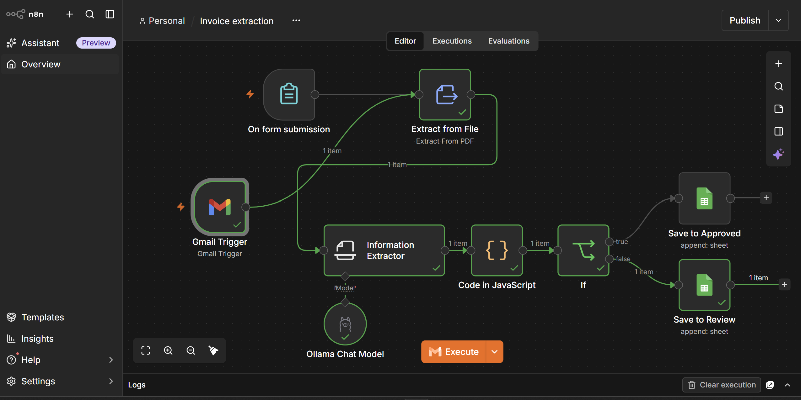
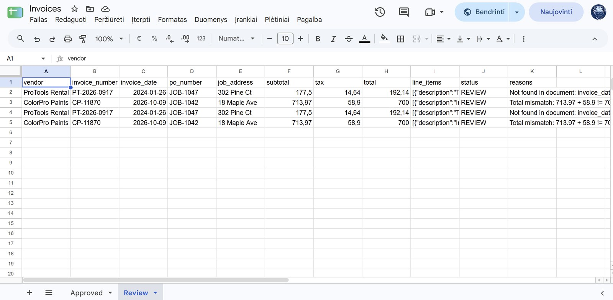

# Invoice extraction with validation

PDF invoices arrive by email or through a web form. AI extracts the fields, code checks each value against the document and the maths, clean invoices go to an **Approved** tab and questionable ones to a **Review** tab with the exact reason.

Tested with fictional invoices.

## What it does

- **Three ways in:** new email with a PDF attachment, a web form upload, or a one-click run that processes the unread backlog.
- **Extraction:** a local LLM returns vendor, invoice number, dates, PO number, job address, subtotal, tax, total and line items as structured data. Missing values come back empty, never guessed.
- **Validation in code:**
  - required fields present;
  - invoice number, date, PO and address must appear in the document text;
  - subtotal + tax must equal the total;
  - the invoice date must be plausible.
- **Routing:** clean invoices to Approved, the rest to Review with every failed check listed. Each Review item also sends an email to the team.
- **No duplicates:** rows are matched on the invoice number, so re-processing updates instead of adding.
- **Housekeeping:** processed emails are marked as read; a separate error workflow emails an alert with the failed step if anything breaks.

## Lessons learned

| Symptom | Cause | Fix |
| --- | --- | --- |
| An invoice with no date got a date anyway | The model filled a gap with a plausible value | Prompt rule "return null, never guess" plus a check that the date appears in the document |
| PO reference was cut short | Two different facts (PO and job address) shared one field | Split into two fields with their own checks |
| Totals looked fine but didn't add up on one invoice | Extraction can be right while the document itself is wrong | Arithmetic check in code; mismatches go to review |

## Built with

n8n (self-hosted), Gmail API, Google Sheets, local LLM via Ollama, JavaScript.
