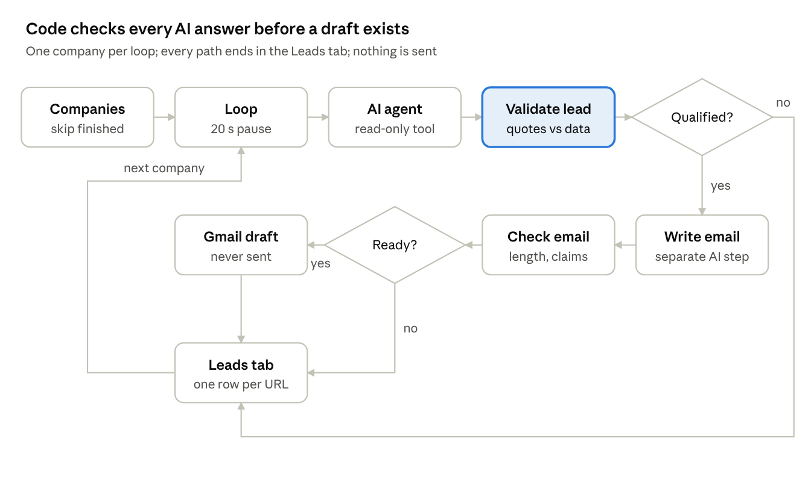
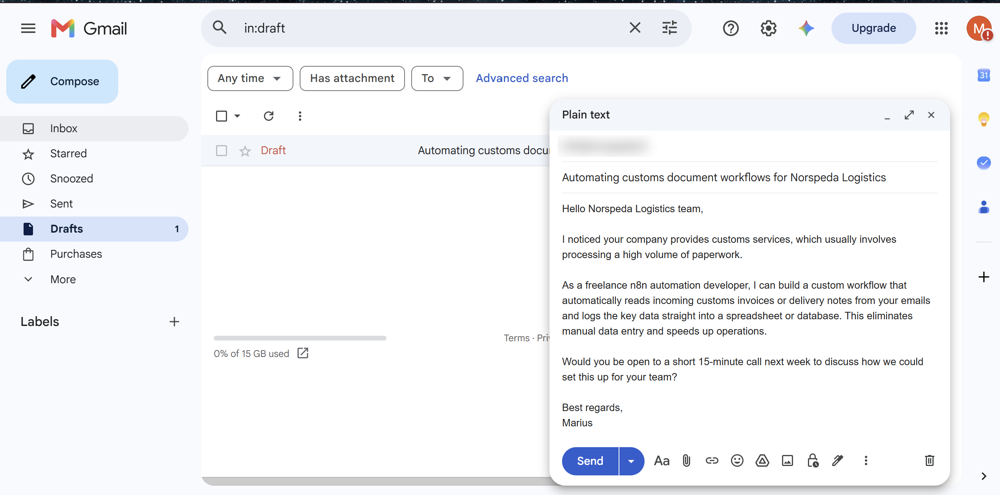

# AI lead qualification agent with human-approved email drafts

An AI agent pre-qualifies companies against fixed criteria and must quote its evidence. Code verifies every quote before the decision is accepted. Qualified leads get a short, specific email draft in Gmail, which a person reviews and sends. Nothing is sent automatically.

## What it does

- **Decision:** yes, no or unsure, one sentence of reasoning and 1–3 quotes from the company's own data.
- **Evidence check in code:** every quote must be found in the company data or the page the agent read. No evidence, or evidence that isn't there, means review.
- **Email draft:** a separate AI step writes the email only for qualified leads. Code checks length, placeholders, signature and that a public address exists. Personal addresses (e.g. Gmail) are flagged for a GDPR check before sending.
- **Leads tab:** one row per company with status, reasons, evidence and the draft.
- **Re-runs are safe:** finished companies are skipped, failed ones retried, one company at a time with a pause to respect API rate limits.

## Safety by design

| The agent can | The agent cannot |
| --- | --- |
| Read the company data it is given | Send, edit or delete anything |
| Read one page of the same company's website | Open any other domain |
| Return a decision as text | Create drafts or write to the sheet |

The page tool builds its URL from the company's own domain; the agent only chooses the path. A hidden instruction on a website has no tool to act through. This protection lives in the workflow, not in the prompt.

## Lessons learned

| Symptom | Cause | Fix |
| --- | --- | --- |
| Agent called the page tool in a loop | A small local model ignored "use the tool at most once"; guessed paths returned 404 | Iteration limit, 404 returned as text, errors routed to review, switched to a larger hosted model |
| An accounting firm rejected with no evidence | One model asked to classify, quote and write at once | Split into two AI steps; evidence mandatory and verified |
| A correct decision sent to review | The model copied a prompt label into its quote | Known labels stripped before comparing |
| An email implied past clients | No rule against implied experience | "Offer to build, never claim past clients or results" |
| Most companies failed with "too many requests" | All AI calls fired at once | One company per loop iteration with a pause |

## Results of the test run

11 companies → 3 drafts, 1 held for review (no public email), 7 not a fit (software vendors). No duplicates after repeated runs.

## Built with

n8n AI Agent, Google Gemini, HTTP tool, JavaScript, Google Sheets, Gmail API.
